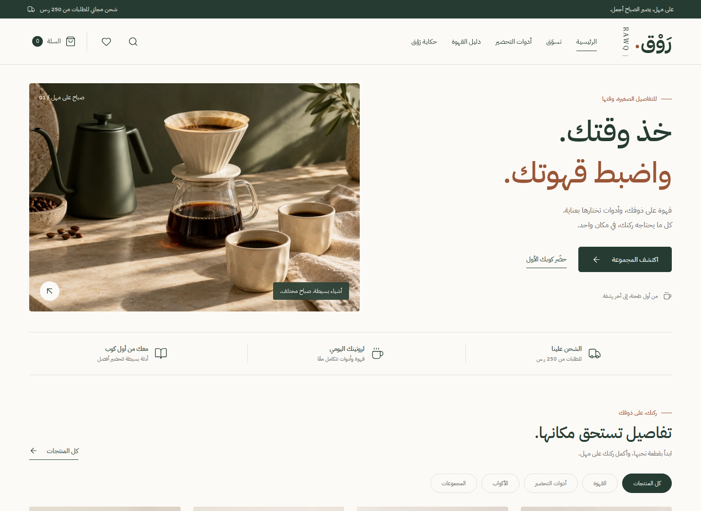

# رَوْق — RAWQ

متجر عربي للقهوة وأدوات التحضير، بواجهة متجاوبة من اليمين إلى اليسار. مشروع تجريبي لمعرض أعمال، مبني باستخدام HTML وCSS وJavaScript.



## التجربة

- كتالوج من 6 منتجات مع البحث والتصفية والترتيب، وخيارات الطحن.
- سلة ومفضلة تحفظان الاختيارات في المتصفح، وحساب الخصم والشحن بوحدة الهللة.
- نموذج طلب ببيانات تجريبية جاهزة للتعديل، والمناطق الإدارية الـ13، وعنوان مقسّم إلى الحي والشارع ورقم المبنى.
- رمز الخصم `RAWQ10`، واختيار التوصيل أو الاستلام، وملخص طلب قابل للطباعة.
- أدلة للقهوة، وحاسبة للتحضير، ومؤقت تفاعلي.
- تحميل الصور قرب ظهورها مع حجز أبعادها مسبقًا، وأرقام بصيغة 0–9.
- دعم لوحة المفاتيح، والتسميات المقروءة آليًا، وتقليل الحركة.

لا توجد بوابة دفع أو خدمة شحن أو خادم خلفي. بيانات نموذج الطلب لا تُرسل ولا تُحفظ؛ يحتفظ المتصفح باختيارات المنتجات فقط. الخطوط والصور والأيقونات محلية.

## التشغيل

افتح `index.html` مباشرة، أو استخدم Node.js 22 أو أحدث:

```bash
npm start
```

ثم افتح `http://127.0.0.1:4173`. العرض الجاهز لا يحتاج إلى تثبيت حزم.

## GitHub Pages

1. ارفع **محتويات هذا المجلد** إلى جذر مستودعك، بحيث يكون `index.html` في الجذر، وأبقِ ملف `.nojekyll`.
2. افتح **Settings → Pages**، ثم اختر **Deploy from a branch**.
3. اختر الفرع الذي رفعت إليه المشروع، والمجلد **/(root)**، ثم **Save**.

الملفات الجاهزة مرفقة، فلا يلزم إعداد عملية بناء على GitHub. المسارات نسبية، ويعمل المتجر تحت مسار المستودع أو على النطاق مباشرة. [تعليمات GitHub الرسمية](https://docs.github.com/en/pages/getting-started-with-github-pages/configuring-a-publishing-source-for-your-github-pages-site).

## الملفات

| المسار         | الاستخدام                                                |
| -------------- | -------------------------------------------------------- |
| `index.html`   | الصفحة الجاهزة للنشر                                     |
| `style.css`    | التصميم والتجاوب والطباعة                                |
| `assets/`      | ملف التفاعلات الجاهز والصور والخطوط والأيقونات وتراخيصها |
| `src/`         | مصدر الصفحات والمنتجات والحسابات والبيانات التجريبية     |
| `tools/`       | البناء والمعاينة والتصوير                                |
| `tests/`       | اختبارات المنطق والمتصفح والتحميل والوصول                |
| `screenshots/` | 13 لقطة جاهزة للكمبيوتر والجوال                          |

## التعديل

```bash
npm ci
npm run build
npm start
```

بعد تعديل `src/`، أعد البناء لتحديث `index.html` و`assets/store.js`. تعديل `style.css` يظهر مباشرة. تُجهّز الصفحات العامة مسبقًا لتبقى ثابتة عند تحميل التفاعلات. المنتجات في `src/catalog.js`، وبيانات نموذج التجربة والمناطق في `src/checkout.js`.

## الاختبارات واللقطات

```bash
npm test
npx playwright install chromium
npm run test:e2e
npm run test:a11y
npm run test:loading
npm run screenshots
```

تحتاج أدوات المتصفح إلى `npm ci` أولًا. شغّل الأوامر بالتتابع؛ تشغّل خوادمها المؤقتة وتغلقها بنفسها. يتوفر المتغير `BROWSER_PATH` لاستخدام نسخة Chromium محلية.

ينتظر التصوير اكتمال صور الصفحة والخطوط واستقرار التخطيط، ثم يحفظ اللقطات في `screenshots/`. تُستبعد الحزم والتقارير المؤقتة من Git بواسطة `.gitignore`.

## الأصول

- IBM Plex Sans Arabic: ترخيص SIL OFL، مرفق في `assets/fonts/`.
- أيقونات Lucide: ترخيص ISC، مرفق في `assets/icons/`.
- الصور توضيحية ومولّدة خصيصًا لهذا المشروع.
- أسماء المناطق الإدارية: [سعوديبيديا](https://saudipedia.com/مناطق-السعودية).
